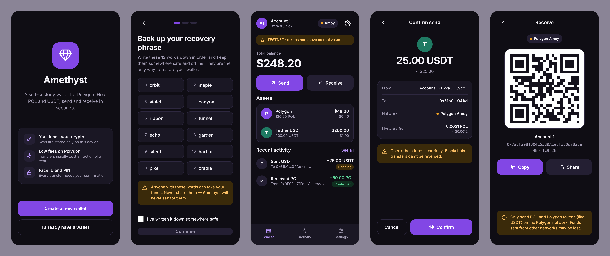
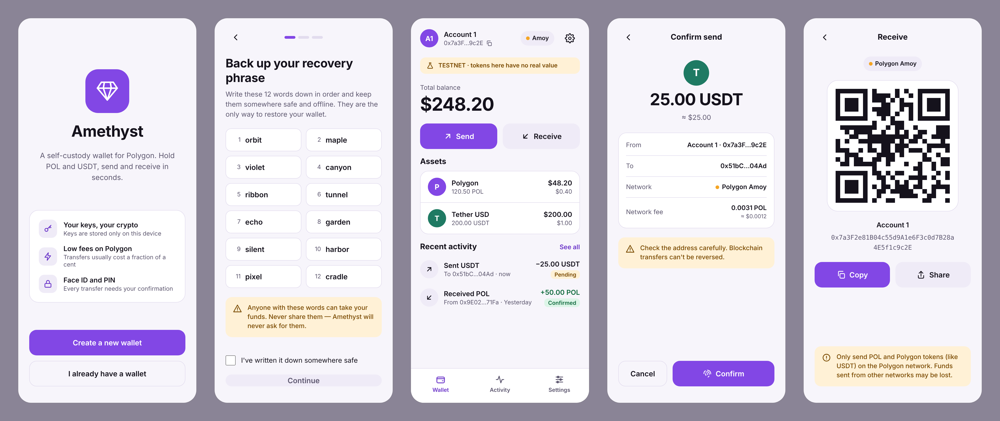
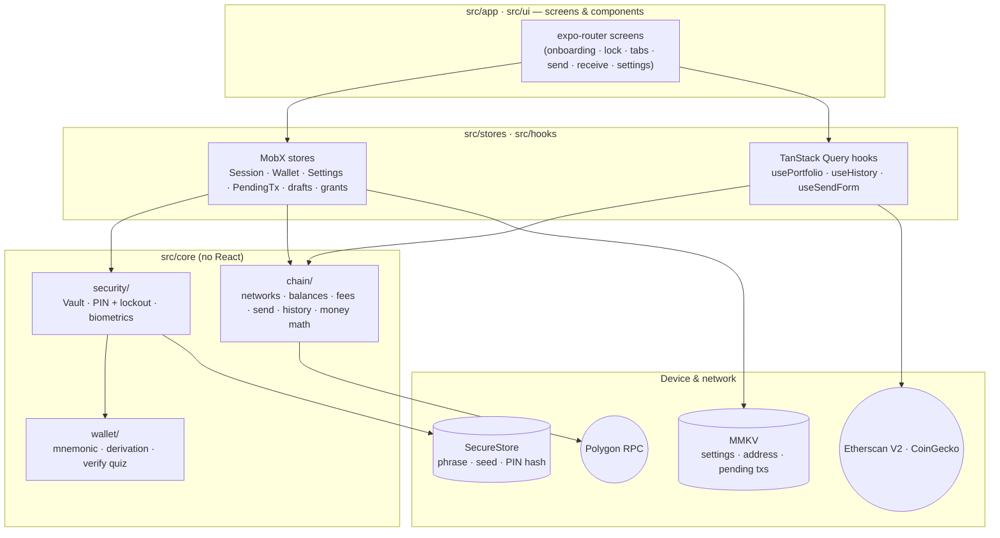
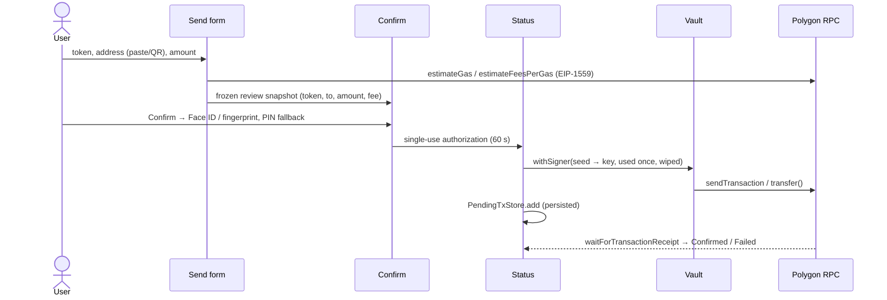

<p align="center">
  
</p>

<h1 align="center">Amethyst</h1>

<p align="center">
  A self-custody wallet for Polygon — hold POL and USDT, send and receive in seconds.<br/>
  Expo · React Native · TypeScript · viem
</p>

<p align="center">
  
</p>

<details>
<summary>Light theme</summary>
<p align="center"></p>
</details>

> **Status:** feature-complete MVP, developed and verified on the **Polygon Amoy testnet**.
> Mainnet is configured but switched off (`MAINNET_ENABLED = false`) until device testing is done.
> The images above are the design mockups; device screenshots go in [`docs/screenshots`](docs/screenshots).

## Features

- **Create or import** a wallet (12/24-word BIP39 phrase, one account at `m/44'/60'/0'/0/0` — same address as MetaMask)
- **Backup flow** — words hidden until tapped, screenshots blocked, verification of words #3, #7, #11
- **Balances** for POL and USDT with USD prices and a total; pull-to-refresh and 30 s polling
- **Receive** — QR code, copy and share
- **Send** POL and USDT — QR scanner, Max, live EIP-1559 fee, funds checks, confirmation with biometrics or PIN
- **History** — incoming and outgoing transfers grouped by day, Pending/Confirmed/Failed, details with explorer links; pending transfers survive app restarts
- **Security** — 6-digit PIN with growing lockout, Face ID / Touch ID / fingerprint, auto-lock after 1 min in background, privacy cover in the app switcher
- **Settings** — network (Amoy / Polygon), theme (system/dark/light), biometrics, show recovery phrase (PIN-gated), delete wallet, "Forgot PIN?"

## Tech stack

| Concern            | Choice                                                                            |
| ------------------ | --------------------------------------------------------------------------------- |
| App                | Expo SDK 58 (dev build, New Architecture), React Native 0.88, TypeScript strict   |
| Navigation         | expo-router (file-based, `Stack.Protected` route guards)                          |
| Styling            | react-native-unistyles 3 — dark/light themes from design tokens                   |
| State              | MobX (app/session state) + TanStack Query (balances, prices, history)             |
| Blockchain         | viem (`viem/accounts`, `viem/chains`), `@scure/bip39`, `@noble/hashes`            |
| Secrets            | expo-secure-store (Keychain / Android Keystore)                                   |
| Non-secret storage | react-native-mmkv                                                                 |
| Device             | expo-local-authentication, expo-camera (QR), expo-screen-capture, expo-clipboard  |
| Data               | Etherscan API V2 (history), CoinGecko (prices), public RPC (drpc.org by default)  |
| Tests              | Jest (jest-expo), React Native Testing Library, live/local-EVM integration suites |

## Architecture



```
src/
  app/          expo-router routes (screens only)
  core/
    wallet/     BIP39/BIP32: generate, validate, derive — pure functions
    security/   Vault (the only code touching secrets), PIN, lockout, biometrics
    chain/      networks/tokens, viem clients, balances, fees, send, receipts, history, money
    storage/    MMKV instance (non-secret data only)
  stores/       MobX: SessionStore, WalletStore, SettingsStore, PendingTxStore, SendDraft…
  hooks/        usePortfolio, useHistory, useSendForm, useUnlock…
  api/          CoinGecko, Etherscan V2, TanStack Query client
  ui/           shared components (Button, PinPad, TxRow, Banner…)
  theme/        design tokens + Unistyles configuration
contracts/      MockUSDT.sol (test ERC-20 for Amoy)
docs/           DECISIONS.md · CHECKLIST.md · MOCK_USDT.md
```

**Rules:** `src/core` never imports React; keys and the phrase are touched only in `core/wallet` and `core/security`;
amounts are `bigint` end to end (`parseUnits`/`formatUnits`, USD in integer cents) — no floats in money math.

### Sending a transfer



## Security model

| Threat / concern                         | Mitigation                                                                                                                                                                                                     |
| ---------------------------------------- | -------------------------------------------------------------------------------------------------------------------------------------------------------------------------------------------------------------- |
| Secret storage                           | Phrase **and** 64-byte seed only in SecureStore (`WHEN_UNLOCKED_THIS_DEVICE_ONLY`, excluded from backups). Never in MobX persistence, MMKV, logs or clipboard.                                                 |
| Key exposure in memory                   | The private key is derived from the seed right before signing and dropped after; seed/key buffers are zeroed (best effort — JS can't guarantee no copies).                                                     |
| Shoulder surfing / screenshots           | Phrase hidden until tapped; `expo-screen-capture` on backup, verify, import and "Show recovery phrase"; logo cover in the app switcher on every screen.                                                        |
| PIN brute force                          | Salted PBKDF2-SHA256; persisted attempt counter; after 5 wrong PINs a growing lockout (30 s → 1 min → 5 min → 15 min → 1 h) that survives restarts. Custom keypad — the PIN never touches the system keyboard. |
| Unattended phone                         | Auto-lock after 1 minute in background; biometric unlock with PIN fallback.                                                                                                                                    |
| Unauthorized transfers                   | Every transfer needs biometrics or the PIN; what's signed is a frozen snapshot of the reviewed screen; the authorization is single-use and expires in 60 s (no double sends).                                  |
| Sending to the wrong address             | `isAddress` with EIP-55 checksum, wrong-chain QR codes rejected, sending to yourself blocked, explicit irreversibility warning.                                                                                |
| Reaching sensitive screens by navigation | "Show recovery phrase" and "Delete wallet" consume a one-time grant issued by a correct PIN — deep links and the back stack can't open them.                                                                   |
| Accidental logging                       | ESLint `no-console` (only `warn`/`error`), no analytics/crash reporting SDKs.                                                                                                                                  |
| Spam tokens                              | History only shows our USDT contract's transfers.                                                                                                                                                              |

Known limits: a rooted/jailbroken device with Keychain/Keystore extraction defeats any app-level protection; the PIN gates the
app, it does not encrypt the seed. Details and trade-offs are in [`docs/DECISIONS.md`](docs/DECISIONS.md).

## Getting started

Amethyst uses native modules (Unistyles, MMKV, Nitro), so it **does not run in Expo Go** — use a development build.

```bash
npm install
cp .env.example .env   # see below

# Local dev build (Xcode / Android Studio)
npm run ios
npm run android

# …or build the dev client with EAS
npx eas-cli@latest build --profile development --platform android
npx eas-cli@latest build --profile development-simulator --platform ios
npm start              # Metro for the installed dev client
```

| Variable                                           | Purpose                                                                                |
| -------------------------------------------------- | -------------------------------------------------------------------------------------- |
| `EXPO_PUBLIC_ETHERSCAN_KEY`                        | Free Etherscan V2 key — full transaction history (Polygon & Amoy are on the free tier) |
| `EXPO_PUBLIC_USDT_AMOY`                            | Address of your MockUSDT on Amoy — see [`docs/MOCK_USDT.md`](docs/MOCK_USDT.md)        |
| `EXPO_PUBLIC_COINGECKO_KEY`                        | Optional CoinGecko demo key if the keyless API rate-limits you                         |
| `EXPO_PUBLIC_RPC_AMOY` / `EXPO_PUBLIC_RPC_POLYGON` | Optional RPC overrides                                                                 |

`EXPO_PUBLIC_*` values are inlined into the bundle — they are public API keys, never secrets.
Test POL: https://faucet.polygon.technology (Amoy).

## Try it on Android

Every push builds an installable **release APK** (arm64, JS bundled, no Metro needed) in GitHub Actions:

1. Repo → **Actions** → **Android APK** → the latest green run → _Artifacts_ → `amethyst-android-apk` (a zip with the `.apk`).
2. Copy the APK to the phone, open it and allow "Install unknown apps" for your file manager / browser.

Test builds include the developer helpers (crypto benchmark, "lock now"). To bake keys into the APK, add
`EXPO_PUBLIC_ETHERSCAN_KEY` (and optionally `EXPO_PUBLIC_COINGECKO_KEY`) as repository **secrets** and
`EXPO_PUBLIC_USDT_AMOY` as a repository **variable** (Settings → Secrets and variables → Actions).
The APK is signed with the Expo template's debug key — fine for testing, not for distribution.

## Testing

```bash
npm test                  # unit + component tests
npm run test:coverage     # with coverage for core/stores/api
npm run test:integration  # live Amoy RPC; Etherscan with a key; local-EVM send e2e when configured
npm run typecheck && npm run lint
```

- **Wallet core:** the spec's acceptance vector (`test … junk` → `0xf39Fd6e5…2266`), the BIP39 reference seed, signature recovery, phrase validation, PIN hashing and lockout, vault write order and repair.
- **Money & chain:** integer USD math, fee/Max/funds rules, address & amount parsing, history normalization and merging, error classification.
- **Screens (RNTL):** import, PIN entry, home, receive, send confirm (biometrics → PIN fallback), activity, settings, recovery phrase, delete wallet.
- **End-to-end send pipeline** on a local chain-80002 EVM with the real MockUSDT: POL and USDT transfers, Max, on-chain failure, insufficient funds.
- CI (GitHub Actions) runs typecheck, lint, tests with coverage and `expo-doctor` on every push.

## Project docs

- [`docs/DECISIONS.md`](docs/DECISIONS.md) — every deviation from the original spec and why
- [`docs/CHECKLIST.md`](docs/CHECKLIST.md) — on-device verification checklist
- [`docs/MOCK_USDT.md`](docs/MOCK_USDT.md) — deploying the test USDT on Amoy

## Out of scope (MVP)

Multiple accounts, WalletConnect / dApp browser, swaps, NFTs, custom tokens, address book, push notifications,
history pagination beyond the latest 50 entries per list.

## License

[MIT](LICENSE) © 2026 GvinP
